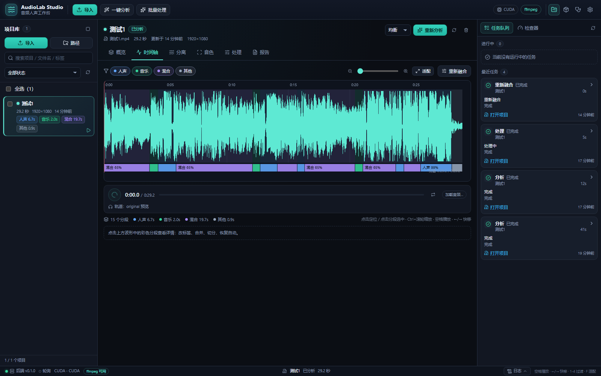

# AudioLab Studio · 音频人声工作台

一个本地 GUI 工作台，把「人声/背景音乐分离」「人声/音乐分类」「按音色聚类人声」「简单音频处理」统一到同一个窗口里。不需要逐个打开 Demucs、ColorSplitter、Silero、ffmpeg 等上游项目。

> 适用素材：音乐、录音/访谈/播客、电影/视频片段。
> 默认全部本地运行，不上传云端；只有下载模型时会访问网络。

## 功能

| 模块 | 说明 |
|---|---|
| 项目库 | 导入音视频、拖拽、原生文件对话框、批量队列、状态筛选、去重 |
| 人声/音乐分类 | 逐段时间轴：纯人声 / 背景音乐 / 人声+音乐 / 静音·音效，附置信度与 AST 标签 |
| 人声/伴奏分离 | BS-Roformer（默认，GPU，可选下载）或 UVR-MDX-NET Inst HQ 4（快速/兜底），导出 vocals/instrumental |
| 音色聚类 | ColorSplitter timbre 嵌入 + 余弦层次聚类，输出簇标签、F0/质心/HNR、代表片段 |
| 音频处理 | `douyin`、`podcast`、`movie`（BGM 自动闪避）、`music`、`clean` 五个预设 |
| 视频回贴 | 处理后的音频可直接 mux 回新 mp4，视频流不重编码 |
| 手动修正 | 改分段标签、合并/切分片段、重命名/合并音色簇、重新融合阈值 |
| 模型中心 | 模型下载/校验/删除/切换，镜像与离线支持 |
| 诊断日志 | ffmpeg/CUDA/模型/磁盘检查，任务日志、进度、取消、重试 |

## 界面



更多截图在 `web/screenshots/`（demo-* 为演示数据，real-* 为真实后端）。

```text
┌──────────────────────────────────────────────────────────────────────┐
│ 顶栏：导入 / 一键分析 / 批量处理 / CUDA / ffmpeg / 设置              │
├───────────────┬──────────────────────────────────┬───────────────────┤
│ 项目库         │ 概览 | 时间轴 | 分离 | 音色 | 处理 | 报告 │ 任务队列/检查器 │
│ 搜索/筛选      │ 波形 + 彩色分段时间轴 + 播放头      │ 进度/日志/取消     │
│ 多选/批量      │ 片段详情/改标签/合并/切分           │ 模型状态/下载      │
└───────────────┴──────────────────────────────────┴───────────────────┘
```

- 深色专业主题，中文界面。
- 时间轴使用 Canvas 自绘，播放使用 Web Audio 多轨同步；均不依赖外部 CDN。
- 桌面窗口由 pywebview + WebView2 提供；不可用时自动回退浏览器。
- 分析完成后生成 `workspace/outputs/<项目>_<id>/report.html`（可离线打开；服务端会自动加 `<base>` 让音频播放器工作）。

## 快速开始

环境要求：Windows 10/11、Python 3.13、ffmpeg 9+、Node/pnpm（仅构建前端时需要）。

```powershell
cd audio-lab
powershell -ExecutionPolicy Bypass -File setup.ps1
```

`setup.ps1` 会：

1. 创建 `.venv`；
2. 如果本机已有 ComfyUI 的 CUDA torch，可通过 `-ComfySite "…\python_embeded\Lib\site-packages"` 或环境变量 `AUDIOLAB_COMFY_SITE` 复用，避免重复下载数 GB；否则安装 `torch==2.14.1+cu130`；
3. 安装 Python 依赖（默认 Tsinghua PyPI 镜像，可用 `-PipIndex` 改）；
4. 安装 `audiolab` 包并构建 `web/dist`；
5. 预下载推荐模型（MDX HQ4 + 音色 + VAD，约 80MB；BS-Roformer/AST 可在模型页按需下载）；
6. 执行 `doctor`。

启动：

```powershell
run_workbench.bat
```

或：

```powershell
.\.venv\Scripts\python.exe -m audiolab studio
```

只启动服务/无窗口调试：

```powershell
.\.venv\Scripts\python.exe -m audiolab studio --no-window --port 7861
```

## 使用流程

1. **导入**：点「导入」选择文件/文件夹，或直接拖入窗口；也可在输入框粘贴本地路径。
2. **分析**：选中项目 →「一键分析」。阶段：抽音轨 → 分离 → VAD/标签 → 融合 → 音色 → 预览/报告。
3. **看时间轴**：颜色区分人声/音乐/混合/其他；点击分段查看置信度和 AST 标签；可改标签、合并、切分。
4. **听分离**：分离页播放原声/人声/伴奏，solo/mute/音量；导出 stem。
5. **看音色**：音色页查看 PCA 散点和簇卡片，试听代表片段，改簇名或合并簇。
6. **处理**：选择 `douyin`/`podcast`/`movie`/`music`/`clean`，调整参数，渲染并试听；可勾选视频回贴。
7. **导出**：项目报告、JSON/CSV、ZIP、处理后的音频/视频。

## 输出结构

```text
workspace/outputs/<项目名>_<id>/
├─ audio/original.wav          48k 立体声
├─ stems/vocals.wav
├─ stems/instrumental.wav
├─ preview/*.m4a               32k AAC，供时间轴试听
├─ peaks/*.json                波形峰值
├─ timeline.json / segments.csv
├─ timbre.json
├─ timbre/clips/*.wav
├─ timbre/cluster_V1/*.wav
├─ processed/<preset>.wav|mp3|m4a
├─ processed/<preset>.mp4      可选，视频回贴
├─ report.html                 离线报告
├─ analysis.json
└─ manifest / 日志
```

## 命令行

```powershell
python -m audiolab doctor
python -m audiolab analyze "你的视频.mp4"
python -m audiolab analyze song.mp3 --quality fast --clusters 2
python -m audiolab process input.mp4 --preset movie --mux-video
python -m audiolab models list
python -m audiolab models fetch
```

## 模型与许可证

| 模型/项目 | 用途 | 许可证 |
|---|---|---|
| python-audio-separator | 分离封装 | MIT |
| BS-Roformer / UVR-MDX-NET 权重 | 人声/伴奏 | 社区模型，商用前请确认上游 |
| ColorSplitter timbre-v1 | 音色嵌入 | MIT |
| Silero VAD | 人声活动 | MIT |
| AST AudioSet | 场景标签 | BSD-3-Clause |
| ffmpeg | 音频处理 | LGPL/GPL（取决于构建） |

完整说明见 [docs/licenses.md](docs/licenses.md)，模型下载清单见 [MODELS.md](MODELS.md)。默认按个人学习/研究使用；商用请自行确认模型权重许可。

## 仓库与发布

- 代码/脚本/文档走 MIT；模型权重、上游库不随仓库分发。
- 上传 GitHub 前请阅读 [docs/PUBLISHING.md](docs/PUBLISHING.md)，里面包含 `.gitignore` 策略、首次提交、创建仓库、推送和发布 Release 的步骤。
- 本机已登录 GitHub 凭据时，可运行 `scripts/publish_github.ps1` 自动创建仓库/推送/打 Release（先加 `-DryRun` 预览）。
- 第三方项目/模型归属见 [THIRD_PARTY.md](THIRD_PARTY.md)。

## 常见问题

- **CUDA 不可用**：`python -m audiolab doctor` 检查；会自动使用 CPU，但分离会慢很多。
- **8GB 显存 OOM**：工作台会自动降级到 MDX 模型；也可在设置中切换快速模型。
- **模型下载失败**：设置 `HF_ENDPOINT=https://hf-mirror.com`，或在模型页重试；BS-Roformer 默认从 `lainlives/audio-separator-models` 镜像下载。
- **前端空白**：运行 `pnpm --dir web build`，再重启工作台。
- **端口占用**：工作台会自动选择 7861 起的空闲端口；也可 `--port` 指定。

## 开发

```powershell
pnpm --dir web install
pnpm --dir web dev      # 前端 7860，代理 /api 到 7861
.\.venv\Scripts\python.exe -m audiolab serve --port 7861
pytest -m "not slow"
```

架构说明见 [docs/architecture.md](docs/architecture.md)，API 契约见 [docs/API_CONTRACT.md](docs/API_CONTRACT.md)。

## 目录

```text
src/audiolab/
  core/       音频流水线（媒体/分离/VAD/标签/融合/音色/处理/报告）
  engines/    引擎与模型注册、下载
  server/     FastAPI、SQLite、任务队列、文件服务
  jobs/       子进程 worker
  studio.py   pywebview 桌面壳
web/          React + TypeScript + Vite 工作台
workspace/    audiolab.db、缓存、输出、日志
models/       模型缓存
```
